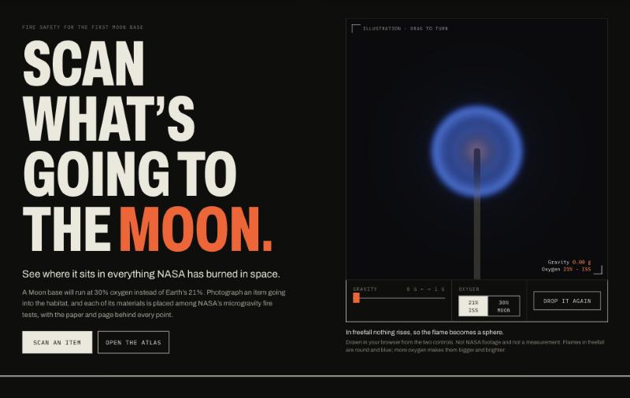
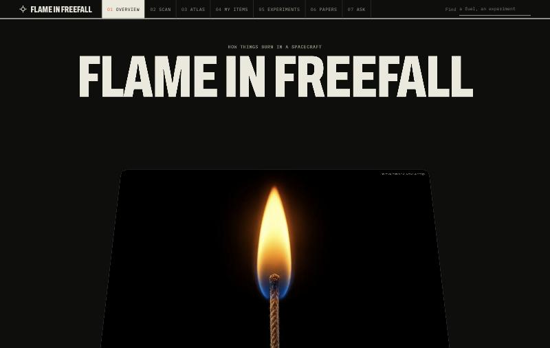
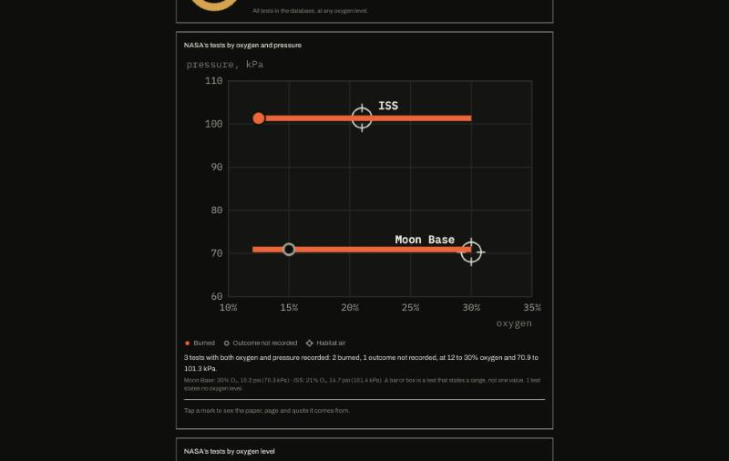
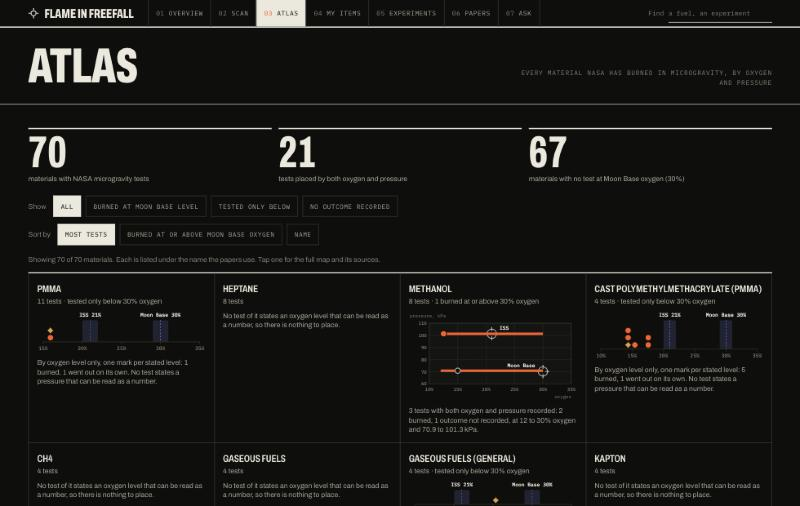
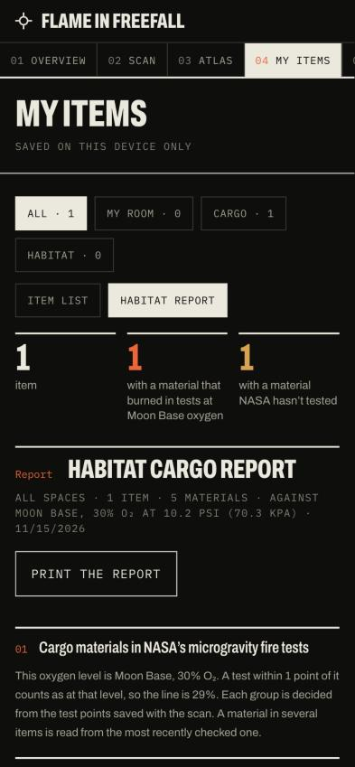

# Flame in Freefall — submission text

NASA Space Apps Challenge 2026. Challenge: *Flame in Freefall: SI-Powered Fire Safety Insights from Microgravity Combustion Data*.

Text for the project page, ready to paste. Items marked **TO FILL IN** need the team.

| | |
|---|---|
| **Project name** | Flame in Freefall |
| **Live project** | https://burnscan.space |
| **Code** | https://github.com/kavintx/nasaspaceappschallenge |
| **Team** | **TO FILL IN**: names and roles |
| **Demo (slides or video)** | **TO FILL IN**: public link |

## High-level summary

A Moon base will run at about 30% oxygen instead of Earth's 21%, and flames behave differently without gravity. Flame in Freefall lets anyone photograph an item going into a habitat and see where each of its materials sits in everything NASA has burned in space. Every NASA microgravity test of a material is placed on a chart by oxygen and pressure and marked by what happened: burned, went out, or did not ignite. Moon Base and ISS conditions are pinned on the same chart, and every point opens the paper, page and quote it came from. Where NASA has no test, the site says so and shows published results from other cited sources, kept separate and labelled. It turns scattered combustion papers into something a habitat designer, a cargo planner or a student can read in a minute, and it shows exactly which materials still need testing.

## What it does

1. **Scan.** Take a photo, scan a care label, or type the materials. An AI vision model proposes the parts and materials; the person confirms or corrects them before anything is looked up. A vague name such as "plastic" asks which plastic, because results are per material.
2. **Flammability map.** For each material, NASA's tests are placed by oxygen (%) and pressure (kPa), with a different shape and colour for each outcome. A test that states a range is drawn as a bar. Moon Base (30% O₂, 10.2 psi) and ISS (21% O₂, 14.7 psi) are marked. Tapping a point shows the paper title, the NASA link, the page, the quote and the outcome note.
3. **Atlas.** Every material with NASA microgravity tests, one small map each. It can be sorted by number of tests or by what burned at Moon Base oxygen, and filtered to materials tested only below that level or with no outcome recorded.
4. **Habitat report.** Scanned items are saved on the device and grouped into spaces. The report groups a space's materials as burned in NASA tests at or above Moon Base oxygen, tested only below it, or never tested in microgravity. It lists NASA's findings under Prevention, Detection and Suppression, each linked to its paper, and prints as a report.
5. **Test next.** For each material in a space, what the data does not contain: "no microgravity test", "no test above 21% O₂", "no test states a pressure". It is worded as a gap in the data, not as a verdict on the item.
6. **Experiments, Papers and Ask.** The 13 experiments and their NTRS papers, with the conditions and findings read from each, and a question box that answers with citations.

## How it addresses the challenge

The challenge asks for fire-safety insight from NASA's microgravity combustion data. The data exists, but it is spread across decades of technical reports, and the test conditions are written as free text. This project:

- **Collects it:** 13 NASA experiments, 44 papers from the NASA Technical Reports Server, 155 test conditions naming 70 fuels, and 231 findings, in one database.
- **Makes it comparable:** oxygen, pressure and airflow are stored as numbers in fixed units as well as the paper's own words, so tests from different papers can sit on one chart.
- **Puts it in front of a decision:** the starting point is a real object, not a search box. The result shows what has been tested near the habitat's atmosphere and what has not.
- **Shows the gaps:** 67 of the 70 fuels have no test at Moon Base oxygen. The atlas and the "test next" list make that visible, which is itself a finding for mission planners.

## Data

**NASA data (the core).** NASA Technical Reports Server papers for the BASS, BASS-II, Saffire I–III, SAME, SAME-R, FLEX, FLEX-2, CFI, ACME, SPICE and SLICE experiments, with the experiment names and descriptions from the challenge brief. Test conditions and findings were read from the papers by an AI model. Each carries the quote it was read from, and almost all the page. None has been reviewed by a person yet, and the site says so wherever they are shown.

**Other cited sources (a separate layer).** 533 published results for 99 materials from 189 documents: NASA reports outside the experiment set, the FAA, NIST, the USDA Forest Products Laboratory, the European Commission, the US Coast Guard, OSHA, Japanese parabolic-flight and Chinese Academy of Sciences experiments, peer-reviewed journals and named manufacturers' data sheets. Each row stores its link, page and exact quote. Every quote was matched by a script against the text of its source, and more than half were also re-opened by a second, independent check. Results marked less than certain were left out. The full list is in [SOURCES.md](SOURCES.md).

**Rules the data follows.**
- No Wikipedia, forums, blogs, or pages that do not say who measured the value.
- A number is used only when the source states it with a unit. "Air", "elevated" or a bare "0.17" are not turned into numbers.
- Results from Earth, weightlessness, lunar gravity and Martian gravity are labelled and never mixed on one chart as if they were the same kind of test.
- Nothing is fitted, predicted or averaged. A material with no test shows "no test found".

## How it was built

- **Site:** Rust (Axum, Askama templates), plain JavaScript, Tailwind CSS. Charts are inline SVG and the home page flame is a WebGL shader; there is no chart or 3D library. Hosted on Netlify.
- **Database:** Postgres on Supabase, read by the site through a read-only public key.
- **Backend:** a separate Rust service ([Fireset](https://github.com/MonsterLXW/Fireset)) that finds NTRS papers, extracts conditions and findings, answers questions with citations and matches material names.
- **Tests:** unit tests for the oxygen, pressure and airflow parser (ranges, unit conversion, unreadable input) and for the source data file.

## Use of artificial intelligence

- **Reading the papers.** An AI model extracted test conditions and findings from the NASA papers. Each has its source page and quote, is marked unreviewed, and can be corrected or rejected.
- **Reading photos.** An AI vision model (Anthropic's Claude) proposes what an item is made of. The person confirms the list before any lookup, and the site says the guess can be wrong.
- **Finding and checking outside sources.** AI research agents found candidate results; a second set of agents re-opened each source independently; a script matched every quote against the source text.
- **Answers.** The Ask page and the optional summaries are generated by an AI model from the database and cite the papers.
- **Code and writing.** The site was written with an AI coding assistant (Anthropic's Claude Code), directed and reviewed by the team.
- **Images.** The intro clip of a candle flame losing gravity was generated with an AI video tool and is labelled "Illustration, made with AI. Not NASA footage" on the page. The other flames are drawn live in the browser and labelled as illustrations. No NASA imagery, logo or branding is used.

## Limits, stated plainly

- Most everyday materials have never been tested in microgravity. For them the site shows Earth results from cited sources, clearly labelled, or nothing.
- Only 21 of 147 fuel-naming test conditions state both an oxygen level and a pressure that can be read as numbers, so most maps are sparse and say "Only N tests".
- The papers' own names for materials are kept, so one material can appear under several spellings.
- The AI-read conditions have not been checked by a person. This is research context for design, not a certification or a safety rating.

## Screenshots

